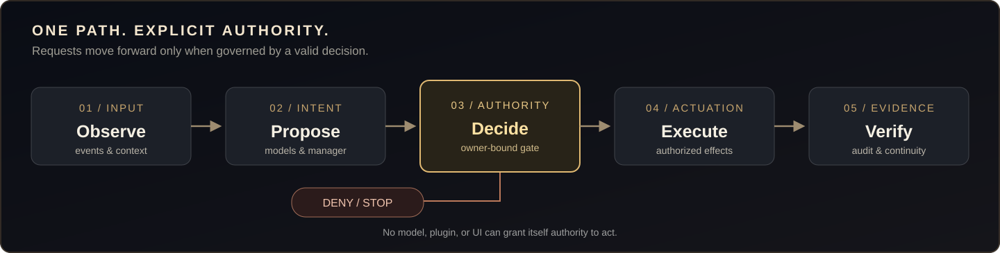

<div align="center">
  
  <h1>DAMAR</h1>
  <p><strong>Damar - Super AI Agent</strong></p>
  <p>A personal AI system built for continuity, coordination, and accountable action.</p>
  <p>
    <a href="https://wisestechnology.com/">Visit Wises Technology</a>
    &nbsp;&nbsp;&nbsp;
    <a href="#getting-started">Get started</a>
    &nbsp;&nbsp;&nbsp;
    <a href="#architecture">Architecture</a>
  </p>
</div>

## About DAMAR

DAMAR is a local-first AI assistant project that brings models, memory, tools, and user interfaces into one governed runtime. It is designed to retain context across sessions and coordinate work without treating a model's suggestion as permission to act.

The goal is a capable personal assistant that can grow through experience while remaining inspectable and under its owner's control.

DAMAR is under active development. The presence of source code or a design document does not mean a feature is deployed, independently certified, or ready for production.

## Explore the system

| Component | Role | Explore |
| :--- | :--- | :--- |
| DAMAR Core | Runtime, model routing, capabilities, memory, and CLI | [Source](src/) and [CLI guide](docs/cli.md) |
| Control Center | Desktop and web interaction surfaces | [Console source](apps/) and [console guide](docs/console.md) |
| Pandawa | Coordination of agents and distributed work | [Mesh runtime](src/mesh/) |
| Mata Dewa | Geospatial context, monitoring research, and environmental risk analysis | [Source](src/mataDewa/) and [capability map](docs/architecture/MATA-DEWA-CAPABILITY-MAP.md) |
| DamarSelf | Identity, continuity, self-model, and experience templates | [DamarSelf](DamarSelf/) |
| Voice and devices | Interaction channels and device integration research | [Voice runtime](docs/VOICE-RUNTIME.md) and [companion devices](docs/COMPANION-DEVICES.md) |

These are engineering areas, not a list of certified live services. Some paths require separate setup, approval, or hardware qualification.

## Architecture

DAMAR separates the ability to reason from the authority to perform an action. Requests pass through the runtime's permission checks. Effects must be verified independently of the model's response.

<div align="center">
  
</div>

The design follows three rules.

1. A model can propose an action but cannot grant itself permission.
2. A tool reporting success is not proof that the intended effect occurred.
3. Decisions, execution, and recovery must remain auditable.

Read the [Authority Gate contract](docs/architecture/ACTION-INTENT-AUTHORITY-GATE-V1.md), [Actuation Fabric](docs/architecture/ACTION-ACTUATION-FABRIC-V1.md), and [Verification and Compensation contract](docs/architecture/ACTION-VERIFICATION-COMPENSATION-V1.md).

## Getting started

The repository CI targets Node.js 22 and 24. Native dependencies and some platform-specific functions may require additional tools, especially on Windows.

```bash
git clone https://github.com/jrxid09-design/Damar.git
cd Damar
npm ci
npm run cli
```

Other available commands are defined in `package.json`.

```bash
npm start
npm run damar
npm test
```

Before starting the host, review [`.env.example`](.env.example) and configure your local environment. Never publish API keys, session files, personal memory, or private infrastructure data. Set an appropriate `DAMAR_TOKEN` before exposing the runtime on a network.

The dependency policy gate runs before dependency installation in GitHub Actions. This does not replace review of the full test results, branch protection, or separate deployment approval.

## DAMAR and Wises Technology

[wisestechnology.com](https://wisestechnology.com/) is the planned public entry point for exploring DAMAR and its visitor-facing experience.

DAMAR and Wises Technology remain separate projects. This link does not establish that a public chatbot, shared backend, or production integration is currently available. GitHub is the source and development home for DAMAR.

## Standalone projects

| Project | Repository | Scope |
| :--- | :--- | :--- |
| DAMAR Cognitive Runtime V3 | [medlest/damar-cognitive-runtime](https://github.com/medlest/damar-cognitive-runtime) | Separate Python runtime and cognitive research. Access may require collaborator permission. Main runtime integration has its own acceptance process. |
| DAMAR HID / DMR-01 | Official repository link pending confirmation | Separate firmware and hardware development. No physical readiness or production release is claimed. |

Research into self-models and consciousness-like functional properties is an ongoing objective. It is not a verified claim of subjective AI consciousness.

## Repository guide

| Location | Contents |
| :--- | :--- |
| [`src/`](src/) | Core runtime and integrations |
| [`apps/`](apps/) | Console and user interfaces |
| [`scripts/`](scripts/) | Runtime commands and supporting tools |
| [`tests/`](tests/) | Automated tests and security regression cases |
| [`docs/architecture/`](docs/architecture/) | System designs and retained technical contracts |
| [`DamarSelf/`](DamarSelf/) | Public identity and continuity templates |
| [`.github/`](.github/) | CI workflows and dependency policy controls |

## Project status

DAMAR is an active engineering project. Its public source and documentation can be explored, but full production readiness has not been certified. Some tests depend on Windows-specific runtime facilities and may not pass on Linux CI runners. Check the [latest GitHub Actions runs](https://github.com/jrxid09-design/Damar/actions) before relying on a build.

## License

See [LICENSE](LICENSE). External dependencies and standalone components may use different licenses. Repository access does not grant permission to operate external systems or physical devices.
