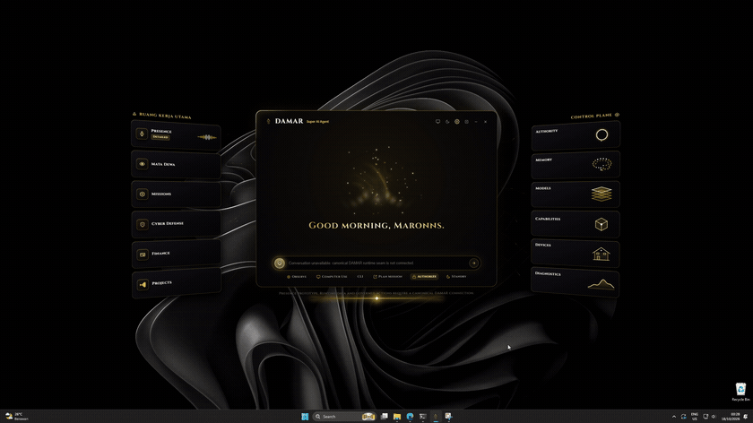
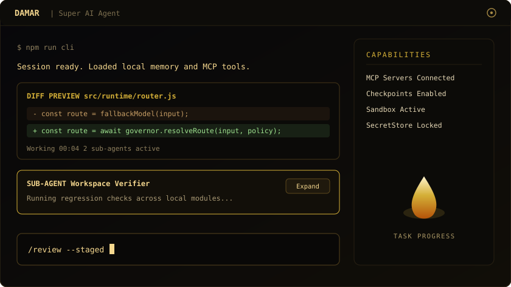

<div align="center">


<br /><br />



<br /><br />

<p>
  <a href="https://wisestechnology.com/">
    
  </a>
  <a href="https://nodejs.org/">
    
  </a>
  <a href="LICENSE">
    
  </a>
  <a href="https://github.com/jrxid09-design/Damar/commits/develop">
    
  </a>
</p>

<p>
  <a href="#live-chat-with-damar"><strong>Live Chat</strong></a>
  &nbsp;&nbsp;&nbsp;
  <a href="#features"><strong>Features</strong></a>
  &nbsp;&nbsp;&nbsp;
  <a href="#live-showcase"><strong>Live Showcase</strong></a>
  &nbsp;&nbsp;&nbsp;
  <a href="#explore-the-system"><strong>Ecosystem</strong></a>
  &nbsp;&nbsp;&nbsp;
  <a href="#getting-started"><strong>Getting Started</strong></a>
</p>

</div>

<br />


## Live Chat with DAMAR

<div align="center">
  <a href="https://wisestechnology.com/">
    
  </a>
</div>

<br />


## About DAMAR

DAMAR is a local AI agent for Windows. One local service (**DAMAR Core**) runs under your account and drives a terminal CLI, a browser Control dashboard, and a desktop Presence with a top-of-screen Notch.

Bring your own model: connect any OpenAI-compatible provider (cloud API or a local server like Ollama / LM Studio), grant the models Core may use — and DAMAR asks your permission before every consequential action.

> [!NOTE]
> Under active development. Source or docs here do not mean a feature is production-ready.

<br />


## Features

- **Terminal agent** — run `damar` in any folder; reads are free, every write or command shows a permission card first.
- **Sandboxed commands** — approved commands run from a fixed allowlist, network-isolated, workspace-only writes.
- **Undo / redo** — `/undo` and `/redo` revert or re-apply the last turn's file changes.
- **Resumable sessions** — `damar resume` reopens saved sessions with transcript and state intact.
- **Project memory** — `/memory add <note>` saves notes (with your approval) for future turns.
- **Parallel sub-agents** — delegate to up to 3 Pandawa specialists at once, each in its own live block.
- **Model grants** — Core only calls models you granted in Control; grants expire and can carry token limits.
- **Honest usage** — token counts come from Core's receipts; DAMAR never estimates cost.
- **Local voice (opt-in)** — off by default; local speech (Supertonic M1), speaker-verified voice ID can gate approvals.
- **Presence & Notch** — greets you by name, shows activity, carries permission requests and now-playing media.
- **Productivity (MCP)** — connect Google Workspace, Microsoft 365, Notion, GitHub, Slack, Spotify, Todoist, Blender, filesystem and web from Control. Standard MCP; every write passes the Authority Gate.
- **Mata Dewa (opt-in)** — public world feeds in Control: earthquakes, weather, air quality, flights, satellites. Nothing loads until you consent.
- **English & Indonesian UI.**

<br />


## Live Showcase

<table align="center" width="100%">
  <tr>
    <td width="50%" valign="top">
      <div align="center">
        
      </div>
      <br />
      <strong>Idle Presence</strong><br />
      <sub>Ambient desktop console with neural particle orb, voice interaction, and command dock.</sub>
    </td>
    <td width="50%" valign="top">
      <div align="center">
        
      </div>
      <br />
      <strong>Damar Notch</strong><br />
      <sub>The desktop console, collapsed into a compact floating notch companion.</sub>
    </td>
  </tr>
  <tr>
    <td width="50%" valign="top">
      <div align="center">
        
      </div>
      <br />
      <strong>Damar CLI</strong><br />
      <sub>Terminal agent with live task progress, diff overlays, and sub-agent cards.</sub>
    </td>
    <td width="50%" valign="top">
      <div align="center">
        
      </div>
      <br />
      <strong>Damar HID</strong><br />
      <sub>Companion hardware research (DMR-01): DAMAR beyond the desktop.</sub>
    </td>
  </tr>
</table>

<br />


## Explore the System

<table align="center" width="100%">
  <tr>
    <td width="50%" valign="top">
      <h4>DAMAR Core</h4>
      <p>Runtime, model routing, memory, CLI, and the MCP productivity suite.</p>
      <p><a href="src/">Source</a> | <a href="docs/cli.md">CLI Guide</a> | <a href="docs/mcp-productivity.md">MCP Productivity</a></p>
    </td>
    <td width="50%" valign="top">
      <h4>Control Center</h4>
      <p>Desktop console, Idle Presence, Damar Notch, and web surfaces.</p>
      <p><a href="apps/desktop/">Console Source</a> | <a href="apps/desktop/release/docs/QUICKSTART.md">Console Guide</a></p>
    </td>
  </tr>
  <tr>
    <td width="50%" valign="top">
      <h4>Pandawa</h4>
      <p>Multi-agent coordination for delegated work.</p>
      <p><a href="src/mesh/">Mesh Runtime</a></p>
    </td>
    <td width="50%" valign="top">
      <h4>Mata Dewa</h4>
      <p>World monitoring: earthquakes, weather, flights, satellites.</p>
      <p><a href="src/mataDewa/">Source</a> | <a href="docs/architecture/MATA-DEWA-CAPABILITY-MAP.md">Capability Map</a></p>
    </td>
  </tr>
  <tr>
    <td width="50%" valign="top">
      <h4>DamarSelf</h4>
      <p>Identity, continuity, and self-model templates.</p>
      <p><a href="DamarSelf/">DamarSelf</a></p>
    </td>
    <td width="50%" valign="top">
      <h4>Voice and Devices</h4>
      <p>Local voice with speaker-verified ID, plus companion device research.</p>
      <p><a href="docs/VOICE-RUNTIME.md">Voice Runtime</a> | <a href="docs/COMPANION-DEVICES.md">Companion Devices</a></p>
    </td>
  </tr>
</table>

<br />


## Getting Started

Windows 10 (1809+) or later, x64. Installer: run `DAMAR-Setup-<version>.exe` — see [INSTALL.md](apps/desktop/release/docs/INSTALL.md). From source:

```powershell
git clone https://github.com/jrxid09-design/Damar.git
cd Damar
powershell -ExecutionPolicy Bypass -File scripts\setup.ps1
npm run damar
```

Then open a terminal in your project folder and run `damar`. First run walks you through connecting a provider in Control — see [QUICKSTART.md](apps/desktop/release/docs/QUICKSTART.md).

<div align="center">
  
</div>

<details>
<summary><strong>Additional Commands and Security Notes</strong></summary>

<br />

CI targets Node.js 18, 20 and 22.

```bash
npm start
npm run damar
npm test
```

> [!WARNING]
> Never publish API keys, session files, or private data. Set a `DAMAR_TOKEN` before exposing the runtime on a network — see [`.env.example`](.env.example).

</details>

<details>
<summary><strong>Documentation</strong></summary>

<br />

| Document | Contents |
|---|---|
| [INSTALL.md](apps/desktop/release/docs/INSTALL.md) | Install, upgrade, uninstall |
| [QUICKSTART.md](apps/desktop/release/docs/QUICKSTART.md) | First run: provider, model grant, first turn |
| [KEYBINDINGS.md](apps/desktop/docs/KEYBINDINGS.md) | CLI keys |
| [SECURITY.md](apps/desktop/release/docs/SECURITY.md) | Permissions, data locations, revoking access |
| [PRIVACY.md](apps/desktop/release/docs/PRIVACY.md) | What leaves your machine, and when |
| [TROUBLESHOOTING.md](apps/desktop/release/docs/TROUBLESHOOTING.md) | Common problems |
| [CHANGELOG.md](apps/desktop/release/docs/CHANGELOG.md) | Release notes |

</details>

<details>
<summary><strong>Known Limitations (v1)</strong></summary>

<br />

- Windows 10 (1809+) / 11, x64 only. One Core per Windows user.
- Core listens on `127.0.0.1:29623` by default (`DAMAR_CORE_PORT` to change).
- Agent commands are limited to the allowlist in Features.
- Undo covers file changes made by DAMAR's write/edit tools only — not command side effects.
- The CLI starts in Indonesian. Type `language en` once to switch.

</details>

<br />


## Standalone Projects

| Project | Repository | Scope |
| :--- | :--- | :--- |
| **Wises Technology** | [wisestechnology.com](https://wisestechnology.com/) | Public entry point and live web chat. |
| **DAMAR Cognitive Runtime V3** | `medlest/damar-cognitive-runtime` | Separate Python runtime and cognitive research. |
| **DAMAR HID / DMR-01** | Official repository link pending confirmation | Firmware and companion hardware. |

## Project Status and License

* **Status:** Active development — check [GitHub Actions](https://github.com/jrxid09-design/Damar/actions) before relying on a build.
* **License:** [MIT License](LICENSE). Third-party licenses ship in `THIRD_PARTY_LICENSES.txt`.
* **Support:** [Discussions](https://github.com/jrxid09-design/Damar/discussions) for questions, [Issues](https://github.com/jrxid09-design/Damar/issues) for bugs. Security issues: report privately per [SECURITY.md](apps/desktop/release/docs/SECURITY.md).

<br />

<div align="center">
  
</div>
