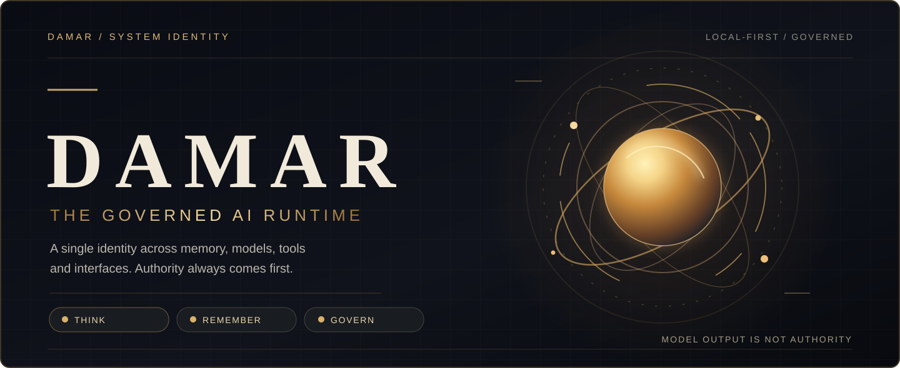
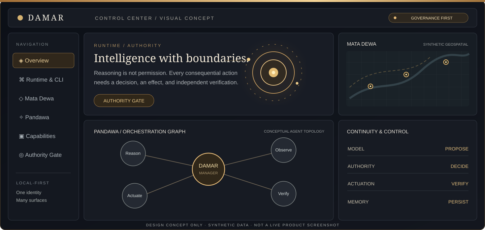

<div align="center">



### ONE IDENTITY · MANY SURFACES · AUTHORITY BEFORE ACTION

**Local-first AI assistant infrastructure · Governed execution · Durable continuity**

<a href="https://wisestechnology.com/"></a>

[Explore the architecture](#architecture) &nbsp;·&nbsp; [Quick start](#quick-start) &nbsp;·&nbsp; [System surfaces](#system-surfaces) &nbsp;·&nbsp; [Standalone repositories](#standalone-repositories) &nbsp;·&nbsp; [Project status](#project-status)

</div>

> [!IMPORTANT]
> **Active engineering project — not a certified production release.** This repository documents a growing implementation and its research objectives. Diagrams and concept art are not evidence of a working deployment, live telemetry, or AI consciousness.

## Meet DAMAR

**DAMAR** is an extensible, local-first AI assistant runtime built around one persistent identity and a strict separation between *reasoning* and *permission to act*.

Models may reason, create plans, and propose tool calls. Consequential actions must be evaluated by the runtime's authority controls, and their effects must be independently verified. Continuity and memory support long-running interactions; they do not replace authorization or ground truth.

| **THINK** | **REMEMBER** | **ACT — WITH AUTHORITY** |
| :--- | :--- | :--- |
| Model routing, context, planning, and action intent | Durable memory, self-models, recovery, and experience | Explicit permission checks, governed execution, and effect verification |
| *Proposal is not permission.* | *Continuity is not infallibility.* | *An execution claim is not proof.* |

## The visual direction



<sub>**Interface concept** — original illustrative artwork using synthetic schematics. This is not a screenshot, actual geospatial monitoring, or real-time performance data.</sub>

The DAMAR experience is envisioned as a coherent control surface for conversation, model routing, devices, memory, and governed operations—not a collection of disconnected AI agents.

## System surfaces

| System | Scope | Source / design reference |
| :--- | :--- | :--- |
| **DAMAR Core &amp; CLI** | Local runtime, orchestration, providers, and command interfaces | [`src/`](src/) · [`scripts/`](scripts/) · [`docs/cli.md`](docs/cli.md) |
| **Control Center** | Console, status, capabilities, and interaction surfaces | [`apps/`](apps/) · [`docs/console.md`](docs/console.md) |
| **Pandawa** | Multi-agent/distributed coordination under governed runtime contracts | [`src/mesh/`](src/mesh/) · [`docs/architecture/`](docs/architecture/) |
| **Mata Dewa** | Geospatial awareness, asset context, and risk research | [`src/mataDewa/`](src/mataDewa/) · [capability map](docs/architecture/MATA-DEWA-CAPABILITY-MAP.md) |
| **DamarSelf &amp; memory** | Identity, continuity, experience, and non-private templates | [`DamarSelf/`](DamarSelf/) · [`src/memory/`](src/memory/) |
| **Voice &amp; devices** | Optional interface channels, device adapters, and future hardware surfaces | [`docs/VOICE-RUNTIME.md`](docs/VOICE-RUNTIME.md) · [`docs/COMPANION-DEVICES.md`](docs/COMPANION-DEVICES.md) |

*Source presence is not proof of live integration, physical-device readiness, or permission to deploy.*

## Architecture


**The central rule: models never become authority.** Tool availability is not permission. A model's success message is not a verified effect. Denied requests must stop at the gate.

Read the [Authority Gate contract](docs/architecture/ACTION-INTENT-AUTHORITY-GATE-V1.md), [Actuation Fabric](docs/architecture/ACTION-ACTUATION-FABRIC-V1.md), and [verification and compensation design](docs/architecture/ACTION-VERIFICATION-COMPENSATION-V1.md).

## Explore DAMAR via Wises Technology

**[wisestechnology.com](https://wisestechnology.com/)** is the intended **public website entry point** for exploring or chatting with DAMAR. GitHub remains the source-code and technical documentation home; the site serves the visitor-facing experience.

**Project boundary:** **DAMAR and Wises are distinct projects.** This website link is navigation, not a claim that Wises code is included in this repository, or that DAMAR's backend and public chat service have been production-certified together. Availability and permissions depend on the website's actual deployment.

## Quick start

The GitHub workflow targets Node.js **22 / 24**. Development may also require native build tools and platform-specific dependencies; consult the individual integration documentation.

```bash
git clone https://github.com/jrxid09-design/Damar.git
cd Damar
npm ci
npm run cli
```

Other available scripts:

```bash
npm start       # local runtime host
npm run damar   # console launcher
npm test        # regression suite (includes platform-specific tests)
```

Use [`.env.example`](.env.example) to create your local configuration. **Protect `DAMAR_TOKEN` and API keys**, especially when binding the service to a network interface. Do not commit real credentials, private infrastructure data, user memory, or runtime state.

> [!NOTE]
> A working dependency installation is not authority to perform external actions. CI's dependency policy gate checks an approved lockfile digest before `npm ci`; the overall test suite and branch protection are separate acceptance concerns. See [GitHub Actions](https://github.com/jrxid09-design/Damar/actions).

## Standalone repositories

| Component | Authoritative source | Relationship to DAMAR |
| :--- | :--- | :--- |
| **DAMAR Cognitive Runtime V3** | [medlest/damar-cognitive-runtime](https://github.com/medlest/damar-cognitive-runtime) | Standalone Python runtime and consciousness-oriented *research*; canonical host integration is a separately controlled effort. Repository access may require collaborator permission. |
| **DAMAR HID / DMR-01** | **Official firmware repository not yet confirmed** | Hardware/firmware is treated as a separate development and qualification track. No unverified upstream URL or production-ready claim. |

Research into consciousness-like functional properties is an engineering objective, **not evidence that DAMAR has subjective awareness**.

## Project map

```text
DAMAR/
├── src/                 Runtime, security, manager, memory, integrations
├── apps/                Console and UI surfaces
├── scripts/             CLI and supported tooling
├── tests/               Regression and security tests
├── DamarSelf/           Non-private identity and continuity templates
├── docs/architecture/   Contracts and technical architecture
├── .github/             CI / D-LOCK policy infrastructure
└── package.json         Runtime commands and dependencies
```

## Project status

| Area | State |
| :--- | :--- |
| Open-source code and local development | **Available** in this repository |
| Public visual identity and interface graphics | **Illustrative design**, not a live UI capture |
| Core integration and authority qualification | **Under active engineering / scope-dependent** |
| Cognitive Runtime V3 &amp; HID | **Standalone workstreams**, not automatically deployed with DAMAR |
| Public production/release readiness | **Not certified** |

For the most current outcomes, inspect the actual implementation, [test suite](tests/), and [Actions runs](https://github.com/jrxid09-design/Damar/actions) rather than treating a README or a badge as certification.

## License

See [LICENSE](LICENSE). Third-party dependencies and standalone components may have their own licenses. Nothing in this repository grants permission to access external systems or operate physical devices.
