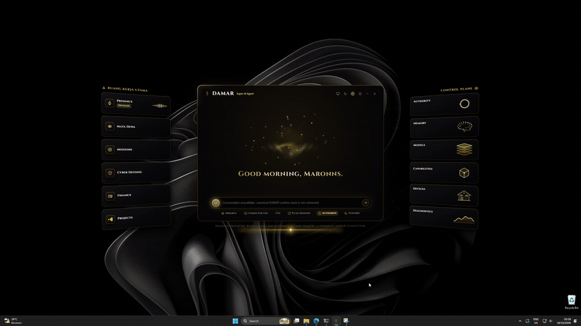
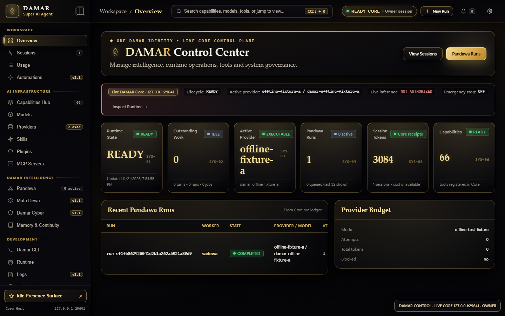
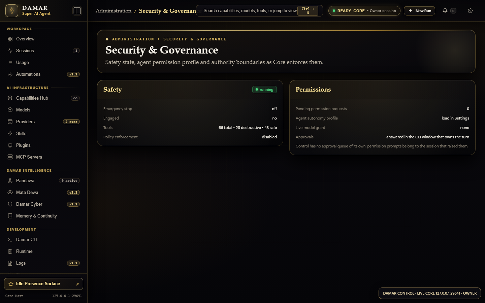
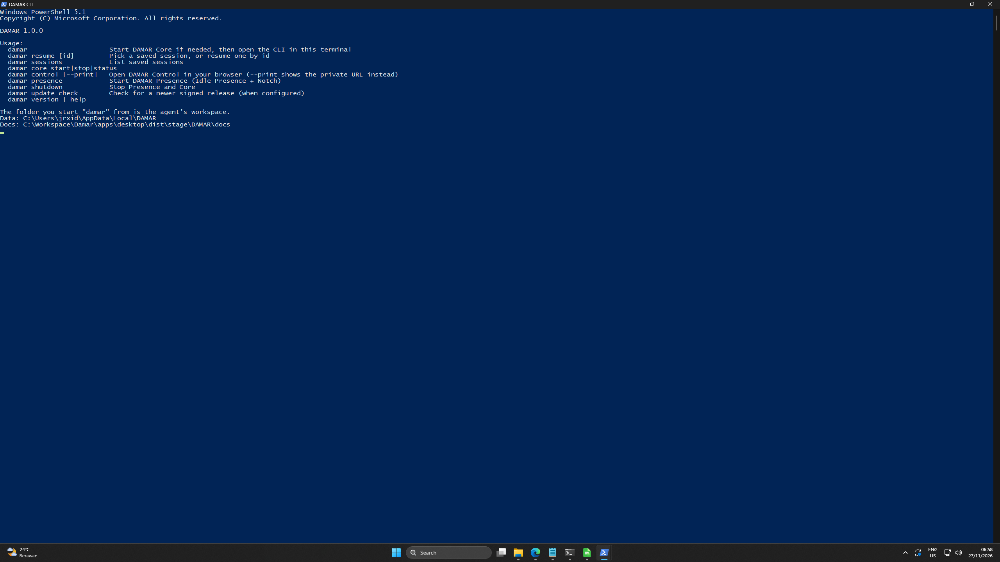

<div align="center">


<br /><br />


<br /><br />

<p>
  <a href="https://wisestechnology.com/">
    
  </a>
  <a href="https://nodejs.org/">
    
  </a>
  <a href="LICENSE">
    
  </a>
  <a href="https://github.com/jrxid09-design/Damar/commits/develop">
    
  </a>
</p>

<p>
  <a href="#live-chat-with-damar"><strong>Live Chat</strong></a>
  &nbsp;&nbsp;&nbsp;
  <a href="#features"><strong>Features</strong></a>
  &nbsp;&nbsp;&nbsp;
  <a href="#live-showcase"><strong>Live Showcase</strong></a>
  &nbsp;&nbsp;&nbsp;
  <a href="#explore-the-system"><strong>Ecosystem</strong></a>
  &nbsp;&nbsp;&nbsp;
  <a href="#getting-started"><strong>Getting Started</strong></a>
</p>

</div>

<br />


## Live Chat with DAMAR

<div align="center">
  <a href="https://wisestechnology.com/">
    
  </a>
</div>

<br />


## About DAMAR

DAMAR is a local AI agent for Windows. A small local service (**DAMAR Core**) runs under your own user account and is driven by:

- **DAMAR CLI**: a full-screen terminal agent. You type requests in plain words; DAMAR reads your project, proposes edits and commands, and asks your permission before each consequential action.
- **DAMAR Control**: a browser dashboard served by Core on `127.0.0.1` for providers, model grants, sessions, usage, settings and security state.
- **DAMAR Presence**: a desktop companion (Idle Presence and a top-of-screen Notch) that shows what Core is doing. When a turn waits for your permission, the Notch shows the full request and lets you answer it, exactly like the CLI card. Voice input is off until you opt in.
- **Mata Dewa**: an opt-in panel in Control showing public world feeds (earthquakes, weather, air quality, flights, satellites, launches). Nothing is fetched until you consent.

DAMAR does not ship with a model. You connect any OpenAI-compatible provider (a cloud API or a local server such as Ollama or LM Studio) and decide which models Core may use. It retains context across sessions and coordinates work without treating a model suggestion as permission to act.

The goal is a capable personal assistant that grows through experience while remaining inspectable and under its owner's control.

> [!NOTE]
> DAMAR is under active development. The presence of source code or a design document does not mean a feature is deployed, independently certified, or ready for production.

<br />


## Features

- **Agent in your terminal.** The folder you start `damar` from is the agent's workspace. Reads are free; every write, edit, command and delegation shows a permission card (Allow once, Allow for this session, Deny). Ctrl+T on the card shows the diff.
- **Contained execution.** Approved commands come from a fixed allowlist (`python -m unittest|py_compile|pytest`, `python <file.py>`, `node --test`, `node --check`, `node <file.js>`). They run in a Windows Job Object inside a no-capability AppContainer with no network access, and can write only inside the workspace.
- **Undo and checkpoints.** `/undo` restores every file DAMAR changed in its last turn and `/redo` re-applies it. Both are verified, and both are refused if you edited the file afterwards.
- **Sessions that survive restarts.** `damar resume` reopens a saved session with its transcript, usage and sub-agent state. Nothing is re-run and no approval is replayed.
- **Project memory.** `/memory add <note>` stores notes for this workspace, after you approve them. They reach later turns in any session.
- **Parallel sub-agents (Pandawa).** You can delegate reviews or tasks to up to 3 specialist runs at once, each shown in its own live block. Set `DAMAR_PANDAWA_PARALLEL` to `1`, `2`, or `3` before starting Core to choose the simultaneous-run cap (default `3`).
- **Model grants.** Core sends a prompt to a live model only if you have granted that model (or `*`) in Control. A grant has an expiry of 1 to 365 days and optional token limits.
- **Usage from receipts.** Token counts come from Core's durable receipts. DAMAR never estimates cost, and unknown usage is shown as unknown.
- **Local voice (opt-in).** Voice stays off until you enable it. Speaker-verified voice ID can gate approvals, and speech runs locally by default (Supertonic M1).
- **Presence and Notch.** Idle Presence greets you by name and shows what Core is doing; the Notch at the top of the screen carries notifications, permission requests and a generic now-playing media view.
- **Productivity (MCP).** From Control's Produktivitas (MCP) view you can connect daily tools — Google Workspace, Microsoft 365, Notion, GitHub, Slack, Spotify, Todoist, Blender, the local filesystem and the web. The suite speaks standard MCP, so any MCP client can connect, and every write action passes through DAMAR's Authority Gate.
- **English and Indonesian** user interfaces.

<br />


## Live Showcase

<table align="center" width="100%">
  <tr>
    <td width="50%" valign="top">
      <div align="center">
        
      </div>
      <br />
      <strong>Idle Presence</strong><br />
      <sub>Ambient spatial desktop console with glowing neural particle orb, live voice interaction, and instant command dock.</sub>
    </td>
    <td width="50%" valign="top">
      <div align="center">
        
      </div>
      <br />
      <strong>Damar Notch</strong><br />
      <sub>Collapses the full desktop console into a compact floating golden orb and notch companion, keeping DAMAR one click away without crowding your screen.</sub>
    </td>
  </tr>
  <tr>
    <td width="50%" valign="top">
      <div align="center">
        
      </div>
      <br />
      <strong>Damar CLI</strong><br />
      <sub>Terminal-native agent interface with live flame task progress, code-diff overlays, MCP capability inspection, sub-agent cards, and slash commands.</sub>
    </td>
    <td width="50%" valign="top">
      <div align="center">
        
      </div>
      <br />
      <strong>Damar HID</strong><br />
      <sub>Dedicated companion hardware and firmware research (DMR-01) bringing ambient DAMAR interaction beyond the desktop.</sub>
    </td>
  </tr>
</table>

<br />

<table align="center" width="100%">
  <tr>
    <td width="50%" valign="top">
      <div align="center">
        
      </div>
      <br />
      <strong>DAMAR Control — Overview</strong><br />
      <sub>Providers, model grants, sessions, usage, settings and security state, served by Core on 127.0.0.1.</sub>
    </td>
    <td width="50%" valign="top">
      <div align="center">
        
      </div>
      <br />
      <strong>Control Center</strong><br />
      <sub>The Control Dashboard is the single place where the whole system is configured.</sub>
    </td>
  </tr>
  <tr>
    <td width="50%" valign="top">
      <div align="center">
        
      </div>
      <br />
      <strong>Produktivitas (MCP)</strong><br />
      <sub>Connect Google Workspace, Microsoft 365, Notion, GitHub, Slack, Spotify, Todoist, Blender, the local filesystem and the web.</sub>
    </td>
    <td width="50%" valign="top">
      <div align="center">
        
      </div>
      <br />
      <strong>Security and Governance</strong><br />
      <sub>Permission prompts, model grants and the Authority Gate keep every consequential action under your control.</sub>
    </td>
  </tr>
  <tr>
    <td width="50%" valign="top">
      <div align="center">
        
      </div>
      <br />
      <strong>Idle Presence (actual UI)</strong><br />
      <sub>Greets you by name and shows what Core is doing.</sub>
    </td>
    <td width="50%" valign="top">
      <div align="center">
        
      </div>
      <br />
      <strong>Damar Notch (actual UI)</strong><br />
      <sub>Notifications, permission requests and a generic now-playing media view at the top of your screen.</sub>
    </td>
  </tr>
</table>

<br />


## Explore the System

<table align="center" width="100%">
  <tr>
    <td width="50%" valign="top">
      <h4>DAMAR Core</h4>
      <p>Runtime, model routing, capabilities, memory engine, interactive CLI, and the MCP productivity suite.</p>
      <p><a href="src/">Source</a> | <a href="docs/cli.md">CLI Guide</a> | <a href="docs/mcp-productivity.md">MCP Productivity</a></p>
    </td>
    <td width="50%" valign="top">
      <h4>Control Center</h4>
      <p>Desktop spatial console, Idle Presence, Damar Notch, and web interaction surfaces.</p>
      <p><a href="apps/desktop/">Console Source</a> | <a href="apps/desktop/release/docs/QUICKSTART.md">Console Guide</a></p>
    </td>
  </tr>
  <tr>
    <td width="50%" valign="top">
      <h4>Pandawa</h4>
      <p>Multi-agent coordination layer for distributed planning and delegated work.</p>
      <p><a href="src/mesh/">Mesh Runtime</a></p>
    </td>
    <td width="50%" valign="top">
      <h4>Mata Dewa</h4>
      <p>Geospatial context, monitoring research, and environmental risk analysis.</p>
      <p><a href="src/mataDewa/">Source</a> | <a href="docs/architecture/MATA-DEWA-CAPABILITY-MAP.md">Capability Map</a></p>
    </td>
  </tr>
  <tr>
    <td width="50%" valign="top">
      <h4>DamarSelf</h4>
      <p>Identity, continuity, self-model scaffolding, and experience templates.</p>
      <p><a href="DamarSelf/">DamarSelf</a></p>
    </td>
    <td width="50%" valign="top">
      <h4>Voice and Devices</h4>
      <p>Interaction channels, voice runtime with speaker-verified voice ID and local Supertonic M1 speech, and companion device integration research.</p>
      <p><a href="docs/VOICE-RUNTIME.md">Voice Runtime</a> | <a href="docs/COMPANION-DEVICES.md">Companion Devices</a></p>
    </td>
  </tr>
</table>

<br />


## Getting Started

DAMAR runs on Windows 10 (1809) or later, x64. If you have the installer, run `DAMAR-Setup-<version>.exe` (per-user, no administrator rights; the current release candidate is unsigned) — see [INSTALL.md](apps/desktop/release/docs/INSTALL.md). To run from source, you only need Git and an internet connection; the setup bootstraps whatever else it needs:

```powershell
git clone https://github.com/jrxid09-design/Damar.git
cd Damar
powershell -ExecutionPolicy Bypass -File scripts\setup.ps1
```

`setup.ps1` is a smart bootstrapper, not a file copier. It audits your PC first — Node.js, Python, the Visual C++ runtime, free disk space — and downloads anything missing from its official source into Damar's own folders (portable, hash-verified; no administrator rights, no system-wide installs). It then installs the app dependencies, downloads the local voice models (±1.2 GB, SHA-256 verified; a failed download never blocks the install — re-run `npm run setup:voice` to finish it), registers the `damar` command on your user PATH, and leaves a **Damar** shortcut on your desktop and in the Start menu. It ends with a preflight report — also written to `data/setup-report.json`. Re-running it on a complete machine changes nothing.

Afterwards:

1. Start the daemon once from the clone with `npm run damar`.
2. Connect a provider and grant a model in DAMAR Control — the first-run onboarding walks you through it. See [QUICKSTART.md](apps/desktop/release/docs/QUICKSTART.md).
3. Open a new terminal in a project folder and run `damar`. Remove the command again with `npm uninstall -g damar`.

<div align="center">
  
</div>

<details>
<summary><strong>Additional Commands and Security Notes</strong></summary>

<br />

The repository CI targets Node.js 18, 20 and 22. Native dependencies and some platform-specific functions may require additional build tools, especially on Windows.

```bash
npm start
npm run damar
npm test
```

> [!WARNING]
> Review [`.env.example`](.env.example) and configure your local environment before starting the host. Never publish API keys, session files, personal memory, or private infrastructure data. Set an appropriate `DAMAR_TOKEN` before exposing the runtime on a network.

</details>

<details>
<summary><strong>Documentation</strong></summary>

<br />

| Document | Contents |
|---|---|
| [INSTALL.md](apps/desktop/release/docs/INSTALL.md) | Install, upgrade, portable zip, uninstall |
| [QUICKSTART.md](apps/desktop/release/docs/QUICKSTART.md) | Connect a provider, grant a model, first CLI turn |
| [KEYBINDINGS.md](apps/desktop/docs/KEYBINDINGS.md) | CLI keys |
| [SECURITY.md](apps/desktop/release/docs/SECURITY.md) | What runs with your rights, permission prompts, data locations, revoking access |
| [PRIVACY.md](apps/desktop/release/docs/PRIVACY.md) | What leaves your machine and when |
| [TROUBLESHOOTING.md](apps/desktop/release/docs/TROUBLESHOOTING.md) | Common problems |
| [CHANGELOG.md](apps/desktop/release/docs/CHANGELOG.md) | Release notes |

</details>

<details>
<summary><strong>Repository Structure</strong></summary>

<br />

```text
Damar/
├── .github/                 CI workflows and dependency policy controls
├── DamarSelf/               Public identity and continuity templates
├── apps/desktop/            Control Center desktop app, Presence, and release docs
├── configs/                 Runtime configuration schemas
├── deploy/                  Deployment manifests and scripts
├── docs/assets/readme/      Official logo, animated SVGs, and showcase media
├── examples/                Reference scenarios and integration examples
├── native/sandbox-host/     Native sandbox host bridge
├── providers/               Model and external service provider adapters
├── scripts/                 Runtime commands and supporting tools
├── src/                     Core runtime, Pandawa mesh, and Mata Dewa
├── tests/                   Automated tests and security regression cases
├── tools/                   Governed tool definitions and adapters
└── userPlugins/             Extensible local user plugins
```

</details>

<details>
<summary><strong>Known Limitations (v1)</strong></summary>

<br />

- Windows 10 (1809+) or Windows 11, x64 only.
- Core listens on `127.0.0.1:29623` by default. Set `DAMAR_CORE_PORT` if that port is taken.
- Only one Core runs per Windows user. A session can be open in one CLI window at a time.
- Agent commands are limited to the allowlist above. Python packages installed outside the bundled interpreter are not visible to sandboxed commands.
- Undo covers files DAMAR changed through its write and edit tools, up to 512 KiB per file. It does not cover the effects of commands DAMAR ran.
- Core sends the 8 most recent messages plus older ones it judges relevant, so very old turns of a long session may not reach the model.
- Cancelling a running sub-agent discards its result, but a provider call already in flight still completes and is still counted.
- In Windows Terminal, combining marks and ZWJ emoji may render incorrectly. The legacy console renders them correctly.
- The CLI starts in Indonesian. Type `language en` once and the choice is saved.
- DAMAR Core runs in production mode. Its old inherited preview pages have been retired; DAMAR Control is the only dashboard.
- The optional Windows protected-authority service is not part of v1. Grants are protected by a per-user witness instead (see SECURITY.md).

</details>

<br />


## Standalone Projects

| Project | Repository | Scope |
| :--- | :--- | :--- |
| **Wises Technology** | [wisestechnology.com](https://wisestechnology.com/) | Public entry point and live web chat experience for exploring DAMAR. |
| **DAMAR Cognitive Runtime V3** | `medlest/damar-cognitive-runtime` | Separate Python runtime and cognitive research. |
| **DAMAR HID / DMR-01** | Official repository link pending confirmation | Separate firmware and companion hardware development. |

## Contributors

- **Maronns** — creator and lead developer of DAMAR.

## Project Status and License

* **Status:** Active engineering project. Check the [latest GitHub Actions runs](https://github.com/jrxid09-design/Damar/actions) before relying on a build.
* **License:** Released under the [MIT License](LICENSE). Third-party licenses are in `THIRD_PARTY_LICENSES.txt` in the install folder.
* **Support:** Questions and ideas via [GitHub Discussions](https://github.com/jrxid09-design/Damar/discussions); bugs via [GitHub Issues](https://github.com/jrxid09-design/Damar/issues) — include the output of `damar version` and `damar core status`. Security issues: report them privately as described in [SECURITY.md](apps/desktop/release/docs/SECURITY.md).

<br />

<div align="center">
  
</div>
