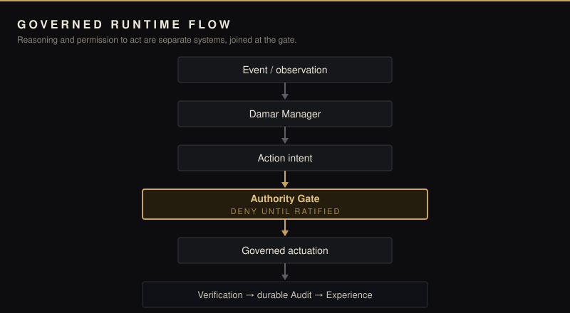
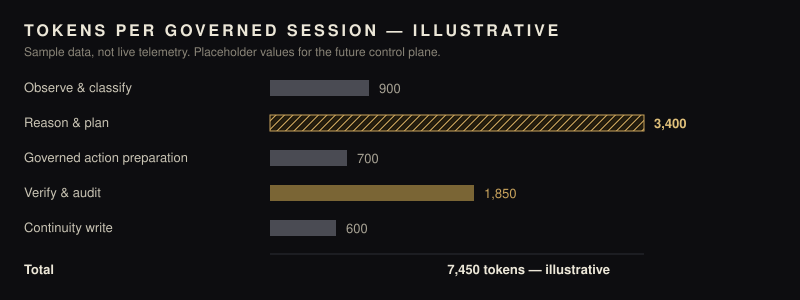
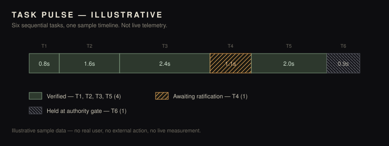

# DAMAR

**A governed personal AI runtime where models never become authority.**

Status: `R12C — RI validator/trust-boundary certified` · `R13 in progress — not certified` · `No active release freeze`

Damar separates *reasoning* from *permission to act*. A model can read, plan, and propose — but an action only becomes real when it passes through an explicit authority gate, is ratified, and is then verified and written to a durable audit trail. One identity persists across surfaces; nothing acts on your behalf just because a model asked nicely.

## Governed runtime flow

Event and observation enter through the Damar Manager, which turns them into an action intent. Nothing executes until the Authority Gate admits it; only ratified intent proceeds to governed actuation, and every result is verified, audited, and folded back into experience.

## Runtime at a glance

| Area | Purpose |
| --- | --- |
| Identity & continuity | One durable identity and long-running state that survives restarts and sessions. |
| Manager & routing | Turns events and observations into a single, inspected decision path. |
| Capability registry | Enumerates what the runtime *can* do — separate from what it is *allowed* to do. |
| Action intent & authority gate | Converts proposals into explicit intents; deny until ratified. |
| Actuation, verification & compensation | Executes within bound authority, checks real effects, and can compensate on failure. |
| Memory, audit & recovery | Durable experience, append-only audit evidence, and rollback paths. |
| Presence & interaction | Surfaces that talk to one identity — never a second brain. |
| Extensions, devices & secrets | External capabilities join as governed tools with controlled credentials. |

Areas describe architecture, not completion. See the status table below.

## Illustrative operating view

> **Illustrative sample data — not live telemetry. Values are placeholders for the future Damar control plane.**

**Tokens in one governed session (sample):** Observe & classify 900 · Reason & plan 3,400 · Governed action preparation 700 · Verify & audit 1,850 · Continuity write 600 — **Total 7,450.**

**Task pulse (sample):** six sequential tasks of 0.8s, 1.6s, 2.4s, 1.1s, 2.0s, 0.9s — four verified, one awaiting ratification, one held.

> **Illustrative sample data — not live telemetry. Values are placeholders for the future Damar control plane.**

Raw sample data: [`docs/readme-data/illustrative-metrics.json`](docs/readme-data/illustrative-metrics.json) (`kind: "illustrative"`, `live: false`). No real user, no external action, no live measurement.

## Current engineering status

| Area | Status |
| --- | --- |
| R12C Runtime Integration validator/trust boundary | Independently certified for that scope |
| Canonical RI freeze | Not active; R13 implementation in progress |
| Presence HOLD/RESUME/STATUS | Not active; R13 implementation in progress |
| Whole-project production readiness | Not declared |

## Operating principles

- One identity, many surfaces.
- Deny until ratified.
- Model output is not authority.
- Tools are not permission.
- Successful command ≠ verified effect.
- External integrations are accelerators, not correctness dependencies.
- Audit evidence outranks documentation.

## Footnote

This README is an overview. For any specific change, the implementation, its tests, and its audit evidence are more authoritative than anything written here — including this page.

Wises is a separate project: compatible with Damar, but not required and not part of this repository's identity. Historical Aether names may appear only in legacy paths and artifacts.
