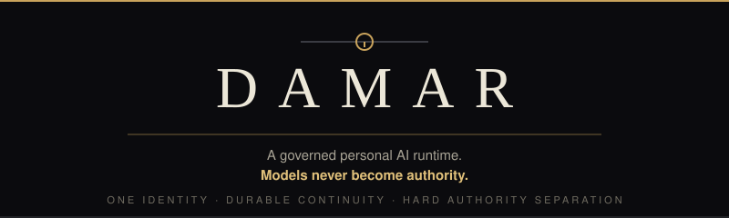
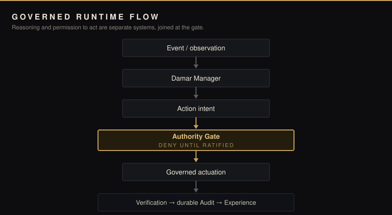

<div align="center">



### ONE IDENTITY. MANY SURFACES. AUTHORITY BEFORE ACTION.

**Local-first AI assistant infrastructure · Governed execution · Durable continuity**

[Explore DAMAR](#explore-damar) · [Quick start](#quick-start) · [Architecture](#how-damar-works) · [Standalone projects](#standalone-projects) · [Project status](#project-status)

</div>

---

> [!IMPORTANT]
> **Active engineering project — not a production-certified release.** Code, diagrams, and tests document what is implemented or being researched; they do not by themselves authorize external actions, prove end-to-end readiness, or establish AI consciousness.

## Meet DAMAR

DAMAR is a **local-first, extensible AI assistant runtime** designed to connect reasoning, memory, tools, and interfaces to a single governed execution path. Models can propose plans and tool calls, but **permission to act is a separate decision**—subject to owner authority, verification, and an auditable result.

The ambition is an assistant that grows more capable through persistent context and experience, while keeping its control boundaries explicit and inspectable.

| **THINK** | **REMEMBER** | **ACT — WITH AUTHORITY** |
| :--- | :--- | :--- |
| Route model reasoning and create action intents | Maintain continuity, context, and recoverable state | Evaluate permissions, execute through governed paths, and verify effects |
| *Proposal is not permission* | *Persistence is not infallibility* | *A tool result is not proof of success* |

## Explore DAMAR

| Surface / system | Purpose | Current scope |
| :--- | :--- | :--- |
| **Core & CLI** | Local runtime, manager, command-line entry points, and capability interfaces | Source in [`src/`](src/) and [`scripts/`](scripts/) |
| **Console** | Interaction and monitoring surfaces | Source in [`apps/`](apps/); availability depends on the build and configuration |
| **Pandawa** | Multi-agent and distributed coordination | Runtime modules and contracts; deployment is separately qualified |
| **Mata Dewa** | Geospatial awareness, asset context, and environmental-risk research | Modules in [`src/mataDewa/`](src/mataDewa/) and [architecture notes](docs/architecture/MATA-DEWA-CAPABILITY-MAP.md); no live surveillance claim |
| **Memory & DamarSelf** | Identity, continuity, self-model, and experience structures | Source and non-private templates in [`DamarSelf/`](DamarSelf/) |
| **Devices & voice** | Optional channels, integrations, and future embedded interfaces | Interfaces and research; hardware readiness is not implied |

### The central rule

**A model may request an action. Only the authorized runtime can permit it.**

## How DAMAR works



<details>
<summary><strong>Why the authority gate matters</strong></summary>

A language model can be persuasive, incorrect, or exposed to untrusted content. DAMAR's architecture separates model outputs from the authority to change files, operate devices, call external services, or perform other effects. Requests must be evaluated within their actual permissions. Denials, outcomes, and verification belong to the runtime—not to a model's self-reported success.

See [Action Intent & Authority Gate](docs/architecture/ACTION-INTENT-AUTHORITY-GATE-V1.md), [Actuation Fabric](docs/architecture/ACTION-ACTUATION-FABRIC-V1.md), and [Verification & Compensation](docs/architecture/ACTION-VERIFICATION-COMPENSATION-V1.md).

</details>

## Quick start

**Prerequisites:** Git and Node.js **22 or 24** (the versions targeted by the current CI matrix). Native dependencies may require additional platform-specific build tools. The repository has not been certified for every host environment.

```bash
git clone https://github.com/jrxid09-design/Damar.git
cd Damar
npm ci
npm run cli
```

On Windows PowerShell, create a local configuration file with:

```powershell
Copy-Item .env.example .env
```

On macOS or Linux:

```bash
cp .env.example .env
```

Edit `.env` before enabling any network-accessible service. For a local-only host, review `HOST` and set a strong `DAMAR_TOKEN`; the example configuration can otherwise bind a service to all network interfaces. **Never commit credentials, sessions, personal memory, or private infrastructure data.**

| Command | Entry point |
| :--- | :--- |
| `npm run cli` | DAMAR CLI |
| `npm start` | Local server |
| `npm run damar` | Console launcher |
| `npm test` | Node.js regression suite |

> [!CAUTION]
> `npm ci` may install native modules and run dependency lifecycle scripts. Inspect dependencies and use an isolated development environment when evaluating unfamiliar code. A successful install or test run is **not** approval to deploy or to perform real-world actions.

## Standalone projects

DAMAR is the host/orchestrator. The components below have separate source-of-truth and acceptance boundaries; cloning this repository does **not** install them automatically.

| Project | Repository | Integration status |
| :--- | :--- | :--- |
| **DAMAR Cognitive Runtime V3** | [`medlest/damar-cognitive-runtime`](https://github.com/medlest/damar-cognitive-runtime) · [standalone handoff](https://github.com/medlest/damar-cognitive-runtime/blob/standalone-v3-handoff-20261104/README.md) | Standalone Python research/runtime project. Access may require collaborator permission; integration into DAMAR is separately gated. |
| **DMR-01 / DAMAR HID** | **Official repository pending verification** | Firmware and physical hardware qualification remain separate; no unverified repository or flash-ready release is represented as official. |

**Interested in the consciousness research?** Start with [Consciousness Evolution](docs/CONSCIOUSNESS-EVOLUTION.md) and the standalone cognitive runtime above. These are engineering and research directions, **not evidence that DAMAR or a model is conscious**.

## Project map

```text
DAMAR/
├── src/                   # Runtime, authorities, integrations, memory
├── apps/                  # Console and user interfaces
├── scripts/               # Launch, tooling, and dependency-policy checks
├── providers/             # Optional provider adapters
├── DamarSelf/             # Non-private identity/continuity templates
├── tests/                 # Regression and security tests
├── docs/                  # Architecture, contracts, and technical guidance
├── .github/               # CI and code ownership
└── .env.example           # Template only — no live credentials
```

**Documentation shortcuts:** [CLI](docs/cli.md) · [Console](docs/console.md) · [Mata Dewa](docs/architecture/MATA-DEWA-CAPABILITY-MAP.md) · [Companion devices](docs/COMPANION-DEVICES.md) · [Architecture decisions](docs/adr/) · [Wave 6 contracts](docs/architecture/wave6/)

## Project status

| Area | What can be established from this repository |
| :--- | :--- |
| **Source distribution** | Curated public tree; generated caches, review evidence, and local AI-agent workspace settings are excluded. |
| **Dependency gate** | CI includes a lockfile/policy check before package installation; actual protection depends on the approved digest and GitHub configuration. |
| **Regression testing** | Tests are present, but a passing result for the entire matrix is **not** claimed. Some AppContainer tests require Windows rather than a Linux runner. |
| **Consciousness research** | Research objective and standalone component; no verified consciousness claim. |
| **Physical devices and production** | No general production or HID deployment authorization is asserted. |

The repository prioritizes **transparent boundaries over inflated readiness badges**. Assess each capability from code, reproducible tests, and the applicable owner acceptance—not from a mock UI, illustration, or architectural diagram.

## License

Consult [LICENSE](LICENSE) for this repository's terms. Standalone components and third-party dependencies may have different licenses and setup requirements.

---

<div align="center">

**DAMAR — BUILT TO REASON. GOVERNED TO ACT.**

<sub>Local-first · Owner-controlled · Continuously evolving as an engineering project</sub>

</div>
