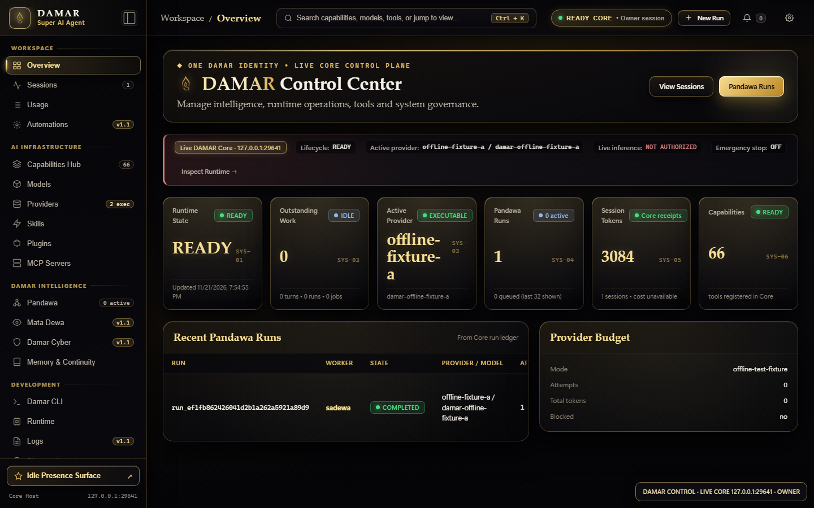
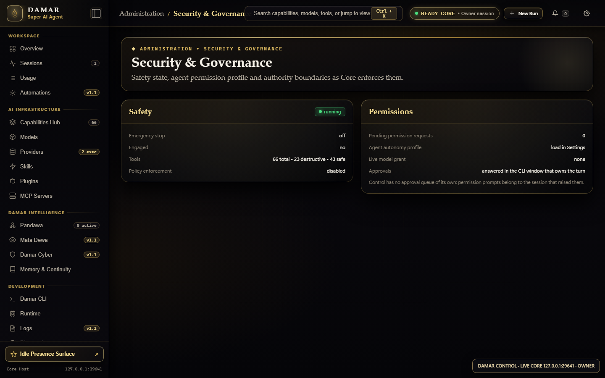

# DAMAR

DAMAR is a local AI agent for Windows. A small local service (**DAMAR Core**) runs under your own user account and is driven by:

- **DAMAR CLI**: a full-screen terminal agent. You type requests in plain words; DAMAR reads your project, proposes edits and commands, and asks your permission before each consequential action.
- **DAMAR Control**: a browser dashboard served by Core on `127.0.0.1` for providers, model grants, sessions, usage, settings and security state.
- **DAMAR Presence**: a desktop companion (Idle Presence and a top-of-screen Notch) that shows what Core is doing. When a turn waits for your permission, the Notch shows the full request and lets you answer it, exactly like the CLI card. Voice input is off until you opt in.
- **Mata Dewa**: an opt-in panel in Control showing public world feeds (earthquakes, weather, air quality, flights, satellites, launches). Nothing is fetched until you consent.

DAMAR does not ship with a model. You connect any OpenAI-compatible provider (a cloud API or a local server such as Ollama or LM Studio) and decide which models Core may use.

## Features

- **Agent in your terminal.** The folder you start `damar` from is the agent's workspace. Reads are free; every write, edit, command and delegation shows a permission card (Allow once, Allow for this session, Deny). Ctrl+T on the card shows the diff.
- **Contained execution.** Approved commands come from a fixed allowlist (`python -m unittest|py_compile|pytest`, `python <file.py>`, `node --test`, `node --check`, `node <file.js>`). They run in a Windows Job Object inside a no-capability AppContainer with no network access, and can write only inside the workspace.
- **Undo and checkpoints.** `/undo` restores every file DAMAR changed in its last turn and `/redo` re-applies it. Both are verified, and both are refused if you edited the file afterwards.
- **Sessions that survive restarts.** `damar resume` reopens a saved session with its transcript, usage and sub-agent state. Nothing is re-run and no approval is replayed.
- **Project memory.** `/memory add <note>` stores notes for this workspace, after you approve them. They reach later turns in any session.
- **Parallel sub-agents (Pandawa).** You can delegate reviews or tasks to up to 3 specialist runs at once, each shown in its own live block. Set `DAMAR_PANDAWA_PARALLEL` to `1`, `2`, or `3` before starting Core to choose the simultaneous-run cap (default `3`).
- **Model grants.** Core sends a prompt to a live model only if you have granted that model (or `*`) in Control. A grant has an expiry of 1 to 365 days and optional token limits.
- **Usage from receipts.** Token counts come from Core's durable receipts. DAMAR never estimates cost, and unknown usage is shown as unknown.
- **English and Indonesian** user interfaces.

## Get started

1. Install: run `DAMAR-Setup-<version>.exe` (per-user, no administrator rights). See [INSTALL.md](INSTALL.md).
2. Connect a provider and grant a model in DAMAR Control. See [QUICKSTART.md](QUICKSTART.md).
3. Open a terminal in a project folder and run `damar`.

## Documentation

| Document | Contents |
|---|---|
| [INSTALL.md](INSTALL.md) | Install, upgrade, portable zip, uninstall |
| [QUICKSTART.md](QUICKSTART.md) | Connect a provider, grant a model, first CLI turn |
| [KEYBINDINGS.md](KEYBINDINGS.md) | CLI keys |
| [SECURITY.md](SECURITY.md) | What runs with your rights, permission prompts, data locations, revoking access |
| [PRIVACY.md](PRIVACY.md) | What leaves your machine and when |
| [TROUBLESHOOTING.md](TROUBLESHOOTING.md) | Common problems |
| [CHANGELOG.md](CHANGELOG.md) | Release notes |

DAMAR is free and open source under the MIT License (`LICENSE.txt`). Third-party licenses are in `THIRD_PARTY_LICENSES.txt` in the install folder.

## Support
- Questions and ideas: GitHub Discussions at https://github.com/jrxid09-design/Damar/discussions
- Bugs: GitHub Issues at https://github.com/jrxid09-design/Damar/issues. Include the output of `damar version` and `damar core status`.
- Security issues: report them privately as described in [SECURITY.md](SECURITY.md).

## Known limitations (v1)

- Windows 10 (1809+) or Windows 11, x64 only.
- Core listens on `127.0.0.1:29623` by default. Set `DAMAR_CORE_PORT` if that port is taken.
- Only one Core runs per Windows user. A session can be open in one CLI window at a time.
- Agent commands are limited to the allowlist above. Python packages installed outside the bundled interpreter are not visible to sandboxed commands.
- Undo covers files DAMAR changed through its write and edit tools, up to 512 KiB per file. It does not cover the effects of commands DAMAR ran.
- Core sends the 8 most recent messages plus older ones it judges relevant, so very old turns of a long session may not reach the model.
- Cancelling a running sub-agent discards its result, but a provider call already in flight still completes and is still counted.
- In Windows Terminal, combining marks and ZWJ emoji may render incorrectly. The legacy console renders them correctly.
- The CLI starts in Indonesian. Type `language en` once and the choice is saved.
- DAMAR Core runs in production mode. Its old inherited preview pages have been retired; DAMAR Control is the only dashboard.
- The optional Windows protected-authority service is not part of v1. Grants are protected by a per-user witness instead (see SECURITY.md).
